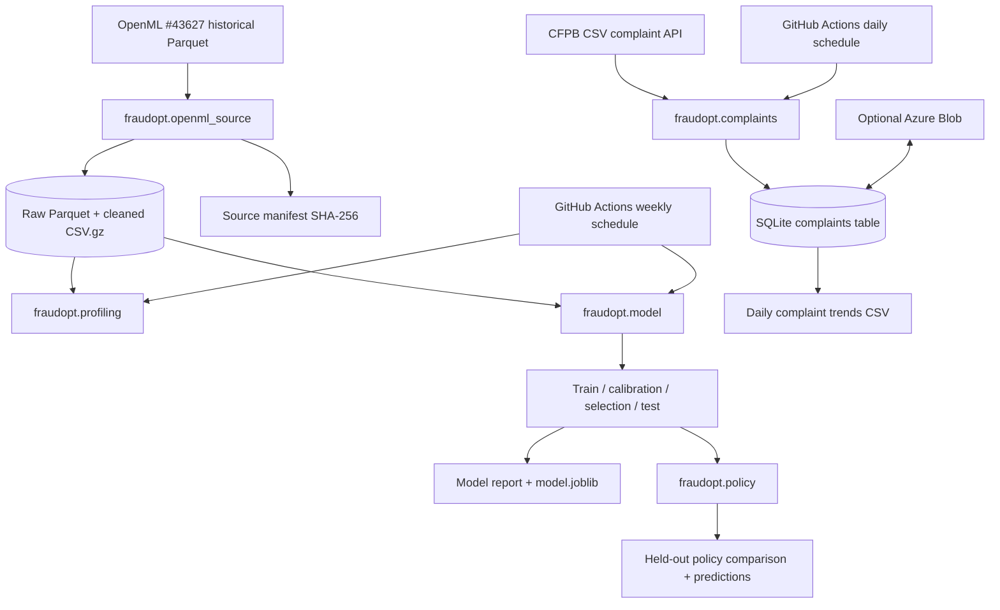
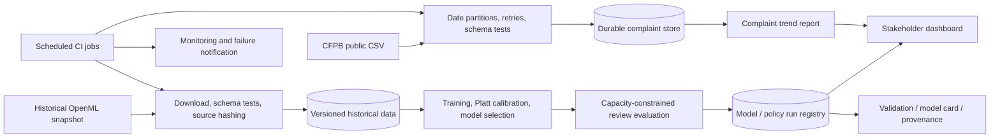

# FraudOpt — Technical Design and Engineering Specification

**Document ID:** FO-TDD-001  
**Version:** 1.0  
**Prepared:** 11 October 2026  
**Status:** As-built starter architecture + explicitly prioritised target improvements  
**Baseline source:** `fraudopt-starter.zip` as inspected on 11 October 2026  
**Related:** [Project Brief](01_PROJECT_BRIEF.md) · [Project Requirements](02_PROJECT_REQUIREMENTS.md)

---

## 1. Architectural principles

1. **No fabricated freshness:** a historical labelled dataset does not become live because a cron job re-downloads it.
2. **Two isolated data products:** card-fraud training is separate from US complaint-category trends; their labels, geographies and sampling frames are incompatible.
3. **Fail closed on data contracts:** an unavailable, malformed or meaningfully changed source should raise an error, not silently degrade the dataset.
4. **Time-aware validation:** fit preprocessing, models, calibrators and decisions without accessing future partition outcomes.
5. **Explicit assumptions:** currencies, investigation costs, intervention effectiveness and counterfactual savings are not observed; treat them as simulation parameters.
6. **Idempotency before scale:** overlapping CFPB windows must update by complaint ID and remain reproducible.
7. **Governance by construction:** source ID, hash, code version, model version, split boundaries and limitation statements should travel with results.
8. **Testability over microservices:** the starter is a small Python package with scheduled commands, not an overengineered real-time fraud system.

## 2. System context and data flow

### 2.1 Current component architecture



**Important discrepancy in the current schedule:** the drawn weekly flow expresses intent; the **actual workflow runs profiling before downloading the dataset**. On a new runner this fails. The fix is detailed in §11.

### 2.2 Target architecture



**Deployment:** local Python/SQLite is the default. GitHub Actions executes stateless scheduled jobs; Azure Blob is an optional state transfer mechanism. A later solution could use managed cloud storage, a database and a simple Streamlit web app, but none is required for the initial model demonstration.

## 3. Current repository and responsibilities

```text
fraudopt-starter/
├── .github/workflows/
│   ├── daily-data.yml            # scheduled CFPB ingestion + optional Azure sync
│   └── weekly-model.yml          # tests, historical profile and modelling; ordering defect
├── fraudopt/
│   ├── cli.py                    # console entry point and commands
│   ├── openml_source.py          # historical download + strict cleaning + manifest
│   ├── complaints.py             # CFPB CSV retrieval + SQLite idempotent upserts
│   ├── profiling.py              # statistical source profile
│   ├── model.py                  # chronological split, two classifiers, calibration
│   ├── policy.py                 # capacity-based selection and simulated utility
│   └── cloud.py                  # optional Azure Blob pull/push of SQLite
├── tests/
│   ├── test_ingestion.py
│   ├── test_model_policy.py
│   └── test_end_to_end.py
├── data/                           # local artefacts; ignored by Git
├── outputs/                        # model and trend outputs; ignored by Git
├── pyproject.toml
└── README.md
```

### Existing exposed commands

```bash
# Create environment
python3.11 -m venv .venv
source .venv/bin/activate                # Windows: .venv\Scripts\activate
python -m pip install -e '.[test,cloud]'
python -m pytest -q

# Historical dataset and modelling
fraudopt ingest-model
fraudopt profile
fraudopt train --capacity-per-day 50

# Public, changing complaint source
fraudopt ingest-complaints --lookback-days 90

# Optional persistence across short-lived runners
fraudopt cloud pull
fraudopt cloud push
```

All subcommands also accept `--root PATH`. The executable is declared in `pyproject.toml` as `fraudopt = fraudopt.cli:main`.

### Runtime and packages (current)

The starter specifies Python `>=3.10`, while GitHub Actions sets Python 3.11. Key pinned **version ranges**, not lockfile pins, are:

- `numpy>=1.24,<3`, `pandas>=2.0,<3`, `scikit-learn>=1.3,<2`;
- `requests>=2.31,<3`, `joblib>=1.3,<2`, `pyarrow>=14,<24`;
- optional `pytest>=7.4,<10` and `azure-storage-blob>=12.19,<13`.

**Target improvement:** capture an actual resolved lockfile or requirements snapshot in each reproducible build, plus Python/OS versions.

## 4. Historical transaction ingestion: source, contracts and transforms

### 4.1 Authoritative source and semantics

**Dataset:** `https://www.openml.org/api/v1/json/data/43627`  
**Current code URL:** `https://data.openml.org/datasets/0004/43627/dataset_43627.pq`

The original description documents approximately two days of European card transactions in **September 2013**, **284,807** observations and **492** positive fraud labels. It does not expose the underlying confidential original variables behind PCA features. `Time` means **elapsed seconds since the first transaction**, not a POSIX timestamp. `Amount` is an observed transaction amount, but its appropriate monetary unit for assumed costs has not been independently established for this simulator.

The code uses direct Parquet ingestion partly to avoid an OpenML convenience-loader path that may omit dataset-ignored attributes such as `Time`; the project needs `Time` for its chronological partitioning. Runtime compatibility should be verified by the first live smoke test.

### 4.2 Data dictionary

| Raw name | Clean name | Type | Constraint | Treatment / role |
|---|---|---|---|---|
| `Time` | `elapsed_seconds` | numeric | finite; >=0 | Chronological ordering, synthetic day index; excluded from model features |
| `V1`…`V28` | unchanged | numeric | finite; required | PCA components; direct model input; semantically opaque |
| `Amount` | `amount` | numeric | finite; >=0 | Used in policy utility and to create `log_amount` |
| — | `log_amount` | numeric derived | `ln(1 + amount)` | Model feature; deterministic and nonnegative |
| `Class` | `is_fraud` | int8 | {0,1} | Target label; never an inference-time feature |

**Feature vector exactly used by current training:** `[V1, V2, ..., V28, log_amount]`. Note that **raw `amount` is not a model feature**, but is a policy input. **Elapsed time is not a model feature**, but is used in splitting and group-capacity construction.

### 4.3 Extract/clean sequence

1. Resolve `data/creditcard_openml_43627.pq`; if present and no refresh requested, reuse it.
2. Otherwise make an HTTPS streaming request with bounded retries for 429/5xx and request timeouts.
3. Write response bytes to a `.download` file and atomically rename on completion.
4. Load with `pandas.read_parquet`.
5. Check all required columns and coerce them to numeric with `errors="raise"`.
6. Reject null, infinite, negative time, negative amount, non-binary target and too-few positives.
7. Retain only source features, rename three fields, cast target, calculate `log_amount`.
8. Stable-sort by `elapsed_seconds`. **Do not drop matching rows** because the dataset has no authoritative payment ID.
9. Assert the pinned source snapshot has 284,807 rows and 492 positive labels.
10. Export `data/creditcard_clean.csv.gz` and `data/creditcard_manifest.json`.

Example canonical transform:

```python
frame = frame.rename(columns={
    "Time": "elapsed_seconds",
    "Amount": "amount",
    "Class": "is_fraud",
})
frame["is_fraud"] = frame["is_fraud"].astype("int8")
frame["log_amount"] = np.log1p(frame["amount"])
frame = frame.sort_values("elapsed_seconds", kind="stable")
```

**Production hardening opportunity:** verify checksum of the *source* Parquet, and compare changed source metadata before overwriting the known-good cleaned snapshot. Currently the manifest hashes the cleaned gzip file and the snapshot row counts are checked.

### 4.4 Schema versioning and invalid rows

The current strategy is **fail rather than drop**. On malformed data, no cleaned output should be treated as valid. For future volume growth, a staged quarantine of invalid rows could be added only after defining thresholds and traceable explanations; dropping fraud labels without audit is not acceptable for this demonstration.

### 4.5 Profiling

`profiling.py` reads the cleaned CSV and generates `outputs/source_profile.json` with:

- source description and exact clean columns;
- null counts, total rows, fraud count and prevalence;
- elapsed-time range;
- amount quantiles at 0%, 50%, 90%, 99% and 100%;
- fraud/transaction counts per elapsed hour;
- explicit non-deduplication and lack-of-calendar-date notes.

**Do not produce geospatial, beneficiary or cardholder plots** from absent source fields.

## 5. CFPB ingestion: contract, retry and state

### 5.1 HTTP source

**Endpoint used by code:** `https://www.consumerfinance.gov/data-research/consumer-complaints/search/api/v1/`

**Current query parameters**:

```text
date_received_min=YYYY-MM-DD       # inclusive
 date_received_max=YYYY-MM-DD       # exclusive
product=Money transfer, virtual currency, or money service
format=csv
```

The code uses `requests` (HTTPS), retries 429 / 500 / 502 / 503 / 504 and a 90-second timeout for complaint requests. The published API also documents product/date filters. **Public CSV export availability and exact returned headers must be checked from a live runner.** As of the CFPB's September 2026 release, public complaint narratives have been removed; July 2026 notes limit filtered CSV exports to 100,000 rows and state that JSON exports were retired. The pipeline intentionally avoids narratives and JSON.

### 5.2 Windowing and incremental strategy

`ingest_cfpb` computes:

- `first = today - timedelta(days=lookback_days)`;
- `end_limit = today + timedelta(days=1)`;
- seven-day request windows between those boundaries.

Each window is half-open `[first_date, end_date)`. If a returned CSV batch has >=100,000 rows, the request window is divided recursively. A single day hitting the cap raises a terminal error rather than silently truncating.

**Limitation:** “incremental” here means **overlap/reconciliation by date received**. It is **not** a true change-data-capture feed: late public releases whose receipt date is older than the rolling horizon will not be discovered unless a longer backfill is run.

### 5.3 Canonical complaint table

The current SQLite DDL is equivalent to:

```sql
CREATE TABLE IF NOT EXISTS complaints (
    complaint_id TEXT PRIMARY KEY,
    date_received TEXT NOT NULL,
    product TEXT NOT NULL,
    issue TEXT NOT NULL,
    sub_issue TEXT NOT NULL,
    state TEXT NOT NULL,
    potential_fraud_issue INTEGER NOT NULL
        CHECK (potential_fraud_issue IN (0,1))
);
CREATE INDEX IF NOT EXISTS idx_complaints_date
    ON complaints(date_received);
```

Public header aliases normalise e.g. `Complaint ID` → `complaint_id`, `Date received` → `date_received`, `Sub-issue` → `sub_issue`. Dates are parsed then stored as ISO strings. No public complaint narrative is retained. Upsert is via `INSERT ... ON CONFLICT(complaint_id) DO UPDATE`, so repeated windows do not multiply records.

The `potential_fraud_issue` field is a **regex indicator derived from issue/sub-issue category text** matching fraud, scam, unauthorised/unauthorized, or identity theft. It cannot be interpreted as a verified fraud incident. Non-matching categories are not proven legitimate either.

The trend query is:

```sql
SELECT date_received,
       COUNT(*) AS complaint_count,
       SUM(potential_fraud_issue) AS potential_fraud_issue_count
FROM complaints
GROUP BY date_received
ORDER BY date_received;
```

It writes `outputs/complaint_daily_trends.csv`.

### 5.4 Transactionality and durability

Within a single process, SQLite inserts run in a transaction. No row-level replication or concurrent-write multiworker guarantees are built into the current architecture. The current workflows define a single **concurrency group** for daily complaint state, reducing simultaneous writes from that workflow.

**Cloud sync:** `fraudopt cloud pull` downloads a complete `complaints.sqlite` object from an Azure Blob container (default `fraudopt-data`) if configured. After ingestion, `fraudopt cloud push` uploads the complete file. This is simple for a portfolio scale, but has important limitations:

- If Azure configuration is absent, a new hosted runner begins with an empty SQLite database each day; outputs are only a rolling-window view.
- A crashed run between local upsert and blob push may lose updates to the persistent copy, but overlapping later runs can recover records still in scope.
- Concurrent external writers are not protected by Azure ETags in the current implementation.
- A full-DB upload becomes inefficient at scale.

**Target refinement:** use optimistic concurrency via blob ETags, create a timestamped backup, and eventually replace file-level cloud state with a managed database for larger volumes. Ensure SQLite is closed (it is, in the current ingestion function) before syncing the DB file.

## 6. Machine learning lifecycle

### 6.1 Split implementation

`split_chronologically` stable-sorts by `elapsed_seconds`, takes row-quantile boundaries at **55%, 70% and 85%**, then assigns using strict `elapsed_seconds` comparisons. This keeps identical time values together. Actual split sizes are **approximately**, not necessarily exactly, 55/15/15/15.

| Set | Intended purpose | Data access |
|---|---|---|
| Train | Fit classifier and fitted preprocessing | No future labels |
| Calibration | Fit probability mapping on separate observations | May use training-fitted model predictions and calibration labels |
| Selection | Choose model based on Average Precision | Does not tune against test labels |
| Test | Final out-of-time reporting and illustrative policy comparison | Should remain untouched until design is fixed |

Each partition must contain both classes; the program raises an error otherwise. The data has about two days of observed transaction activity, so time splits are only a **limited forward holdout**, not evidence of resilience over seasons or years.

### 6.2 Candidate models and hyperparameters (current)

**Baseline**

```python
make_pipeline(
    StandardScaler(),
    LogisticRegression(
        class_weight="balanced",
        solver="lbfgs",
        max_iter=1000,
        random_state=42,
    ),
)
```

**Challenger**

```python
HistGradientBoostingClassifier(
    learning_rate=0.06,
    max_iter=90,
    max_leaf_nodes=15,
    min_samples_leaf=40,
    l2_regularization=10,
    random_state=42,
)
```

The logistic StandardScaler is correctly inside the training pipeline. The code avoids synthetic minority oversampling, which can lead to leakage if misapplied before splitting.

### 6.3 Sigmoid calibration

The `Platt` helper clips raw model probabilities away from 0 and 1, applies a logit transform and fits a logistic regression on the **calibration** subset. During selection/test, it transforms the classifier output through the fitted calibrator.

```python
raw_prob = model.predict_proba(X_calibration)[:, 1]
calibrator = Platt().fit(raw_prob, y_calibration)
selection_prob = calibrator.predict_proba(
    model.predict_proba(X_selection)[:, 1]
)
```

Because fraud positives are rare and the calibration period is small, calibration should be examined using reliability plots and Brier score, with uncertainty caveats. Do not assume sigmoid calibration guarantees perfectly calibrated probabilities under a changed population.

### 6.4 Model selection and metrics

The winner is selected by **selection-set Average Precision**, then scored on the untouched test. The report includes selection candidate metrics and the selected model's test metrics:

- Average Precision (`average_precision_score`);
- ROC-AUC (`roc_auc_score`);
- Brier score (`brier_score_loss`);
- observed fraud prevalence.

It does **not yet** produce full PR curves, calibration charts, precision@K grids, confidence intervals or a drift dashboard. These are target enhancements.

### 6.5 Training artefacts

Current outputs after successful modelling:

```text
outputs/model.joblib
outputs/model_report.json
outputs/test_predictions.csv.gz
```

`model.joblib` holds a dict with `model`, `calibrator`, `features`, `model_name`. It is a Python pickle-derived artefact and **must only be loaded when its origin is trusted**. The predictions file includes anonymised time, amount, true label, risk and Boolean selections for each policy.

## 7. Review policy design and mathematical assumptions

### 7.1 Input definitions

For transaction `i`:

- `p_i` — calibrated estimate of fraud probability;
- `A_i` — observed anonymised `Amount` value;
- `e` — **assumed** effectiveness of investigating/interrupting an actually fraudulent transaction, in [0,1];
- `c_r` — assumed review cost, in the same amount units;
- `c_f` — assumed customer-friction cost if the reviewed transaction is legitimate;
- `K` — maximum selected reviews for each synthetic day.

**Expected incremental value as currently implemented:**

\[
EV_i = p_i A_i e - c_r - (1-p_i)c_f
\]

`rank_by="expected_value"` selects positive-utility transactions, highest first, up to `K`. `rank_by="risk"` selects the highest estimated fraud probabilities up to `K`, even when their expected value is negative. This difference is intentional: it establishes an intelligible comparator.

### 7.2 Grouping and constraints

A synthetic day is computed as:

```python
day_index = np.floor(elapsed_seconds / 86400).astype(int)
```

The program applies capacity independently within each synthetic day. This is a **simulated operational capacity**, not a real branch staffing plan. It validates equal vector lengths, finite values, valid risk probabilities and nonnegative costs/amounts.

**Target enhancement:** pass cost/effectiveness parameters via CLI/YAML/dashboard, rather than the hard-coded training defaults (review cost 10, friction cost 15, effectiveness 0.7).

### 7.3 Realised simulation scoring

The existing `evaluate_policy` computes:

\[
\text{simulated benefit} =
 e \sum_{i \in \text{reviewed and fraud}} A_i
 - c_r \cdot \#(\text{reviewed})
 - c_f \cdot \#(\text{reviewed legitimate})
\]

It also reports reviewed volume, reviewed fraud, false reviewed cases, precision and recall. **This is not a causal estimate of actual losses prevented**. The source has no interventions, losses observed under a counterfactual, or effectiveness data. Treat the calculation as a sensitivity exercise rather than validated value creation.

### 7.4 Bias and robustness considerations

- AP may change with class prevalence; publish the observed class prevalence and a baseline.
- Precision and calibration may move substantially between short time windows.
- The amount-weighted objective depends on numerical `Amount` and its unknown policy cost unit.
- The current policy assumes the same intervention effectiveness and cost structure for every case; this is unrealistic but transparent.
- The final test must not become an iterative model/policy tuning set. Future iterative experimentation should introduce a new holdout or resampling protocol.
- There is no real investigation outcome delay or customer segment feature in the dataset.

## 8. Artefact and run lineage design

### 8.1 Current files

| Path | Current content | Integrity / retention |
|---|---|---|
| `data/creditcard_openml_43627.pq` | Raw historical snapshot | Local cache, not committed |
| `data/creditcard_clean.csv.gz` | Validated clean data | SHA-256 stored in manifest |
| `data/creditcard_manifest.json` | Source ID, counts, timestamp, clean hash | Intended governance artefact |
| `outputs/source_profile.json` | Data-quality profile | Workflow artifact |
| `outputs/model_report.json` | Metrics and model/policy assumptions | Workflow artifact |
| `outputs/model.joblib` | Fitted model+calibrator | Only load trusted files |
| `outputs/test_predictions.csv.gz` | Test scores and selected reviews | Can contain labels, so handle as research data |
| `data/complaints.sqlite` | Public complaint records | Local or optional Azure object |
| `outputs/complaint_daily_trends.csv` | Complaint counts | Daily job artifact |

### 8.2 Target run manifest schema

The following is a **proposed format**, not an existing current output:

```json
{
  "run_id": "2026-10-11T09:00:00Z-gitsha",
  "code_sha": "<40-character-git-commit>",
  "python_version": "3.11.x",
  "source": {"openml_id": 43627, "clean_sha256": "..."},
  "split": {"train_end_seconds": 0, "calibration_end_seconds": 0,
            "selection_end_seconds": 0},
  "model_name": "logistic_regression",
  "model_sha256": "...",
  "policy": {"capacity_per_day": 50, "review_cost_units": 10,
             "friction_cost_units": 15, "effectiveness_assumption": 0.7},
  "evaluation": {"average_precision": null, "brier_score": null},
  "status": "completed",
  "warnings": ["historical snapshot", "simulated policy economics"]
}
```

Replace placeholders and `null` values with actual run results; do not fabricate evaluation numbers. Consider including report/artefact hashes and strict JSON Schema validation.

## 9. Scheduling, deployment and continuous integration

### 9.1 Current schedules

**Daily complaint job:** `.github/workflows/daily-data.yml`

- `cron: '17 5 * * *'` — daily at **05:17 UTC**, best effort;
- checkout, Python 3.11 and package installation with optional cloud dependencies;
- Azure pull (if secret configured), CFPB ingest for 90 days, Azure push;
- upload `outputs/complaint_daily_trends.csv` with 30-day artifact retention;
- workflow-level `concurrency.group` for the complaint store.

**Weekly model job:** `.github/workflows/weekly-model.yml`

- `cron: '43 6 * * 0'` — Sundays at **06:43 UTC**, best effort;
- checkout, Python 3.11, install with test dependencies, run pytest;
- current defect: `fraudopt profile` is called **before** the download implicit in `fraudopt train`;
- after correction, upload model, report, source profile, predictions and source manifest with 60-day artifact retention.

**Critical operational limitation:** GitHub scheduled jobs run only on the default branch; they can be delayed, and inactive public repositories can have their scheduled workflows disabled after 60 days. To verify the system, enable Actions and run both workflows manually once after publishing. Documentation: [GitHub schedule](https://docs.github.com/en/actions/reference/workflows-and-actions/events-that-trigger-workflows#schedule).

### 9.2 Hosting choices

| Environment | Components | Benefits | Limitations |
|---|---|---|---|
| Local laptop | Python CLI, SQLite, downloaded dataset | Easiest development and debugging | Unattended jobs require host to remain running |
| GitHub Actions only | Scheduled Python scripts and uploaded artifacts | Simple automation | Ephemeral state, late/missed schedules, retention limits |
| GitHub Actions + Azure Blob | Above plus durable SQLite blob | Cumulative complaint history | Secret and blob consistency management |
| Planned managed cloud | Managed identity, database, object storage, dashboard | Stronger durability and operational support | Requires infrastructure, security and cost management |

### 9.3 Credentials and identity

Existing `fraudopt.cloud` uses `AZURE_STORAGE_CONNECTION_STRING` (a GitHub Actions secret) and optional `AZURE_STORAGE_CONTAINER` (default `fraudopt-data`). The container must be provisioned before first use. **Do not put connection strings into YAML, code, reports or Git history.** A more robust future approach is workload identity/OIDC for GitHub-to-Azure access and managed identity for Azure-hosted applications. Microsoft's Python SDK recommends passwordless credentials where supported.

## 10. Testing and quality strategy

### 10.1 Existing test coverage

The starter contains **eight Python test functions** across three files:

- Historical schema/transform checks, missing-column rejection;
- CFPB header normalisation, flagging, SQLite idempotent upserts and CSV request contract;
- No shared timestamps across time partitions;
- Policy capacity and invalid score checks;
- Platt probability bounds;
- Artificial-data end-to-end train/evaluate/report smoke test.

Those tests demonstrate internal wiring, not real download availability, valid historical performance or deployment reliability.

### 10.2 Required additional tests

| Test family | Important cases | Purpose |
|---|---|---|
| HTTP contracts | timeout, 429, 500, invalid CSV, missing headers, cap split, filter ignored | Fail loudly on unstable public source |
| Source integrity | source hash change, incomplete raw download, corrupted cached file | Do not publish incorrect data |
| Transformation properties | row-count preservation, monotonic time, `log_amount` finite, schema exact | Deterministic cleaning |
| Temporal leakage | no equal timestamp crossing, feature fitting on train only | Trustworthy evaluation |
| Calibration | independent data, bounds, test isolation | Prevent optimistic probabilities |
| Policy properties | K=0, K greater than set size, invalid costs, negative EV, ties | Correct constrained ranking |
| Persistence | repeated IDs, updated issue, backup/restore, interruption before upload | Durable, idempotent trends |
| Scheduling | fresh runner, command order, artifact existence, failure exit | Unattended operation |
| Model governance | manifest complete, hashes match, warnings always present | Reviewability |
| UI acceptance (planned) | accessible charts, explicit assumptions, no fake currency | Stakeholder safety |

### 10.3 Release quality gates

1. Formatting/lint/types (planned: Ruff + mypy or equivalent) clean.
2. Unit/fixture tests green.
3. Remote source smoke tests green or explicitly blocked with reason.
4. Actual schedule runs green, not merely YAML present.
5. Artefacts linked to code/input hashes.
6. All UI and reports label the strategy as illustrative.

## 11. Known defect and specific code corrections

### 11.1 Critical: weekly workflow ordering

**Current incorrect sequence** (from supplied ZIP):

```yaml
- run: python -m pytest -q
- run: fraudopt profile
- run: fraudopt train --capacity-per-day 50
```

**Required correction**:

```yaml
- run: python -m pytest -q
- run: fraudopt ingest-model
- run: fraudopt profile
- run: fraudopt train --capacity-per-day 50
```

This fix makes the workflow work from a clean runner **assuming the external download succeeds**. It should be accompanied by a fresh GitHub Actions smoke test. Avoid describing the existing unmodified weekly schedule as already operating correctly.

### 11.2 Recommended: force strict raw-source verification

The current code reuses a local raw Parquet cache if it exists; an older or corrupt cache can produce a confusing failure. Add source-file checksums, source-version metadata and a quarantine/re-download strategy when corruption is detected. Verify before replacing a known-good snapshot.

### 11.3 Recommended: make policy assumptions configurable

Currently `run_training` fixes `review_cost=10.0`, `friction_cost=15.0`, `effectiveness=0.7`. Move these to a validated configuration contract, e.g.:

```yaml
# Example target config; not read by the current starter
policy:
  capacity_per_simulated_day: 50
  review_cost_amount_units: 10.0
  false_review_friction_amount_units: 15.0
  intervention_effectiveness: 0.7
```

Validate types and ranges. Record config hashes in the run manifest and evaluate a grid of plausible assumptions instead of reporting one arbitrary outcome.

### 11.4 Recommended: orchestrate a first-run/source smoke test

```bash
python -m pip install -e '.[test]'
python -m pytest -q
fraudopt ingest-model
fraudopt profile
fraudopt train --capacity-per-day 50
fraudopt ingest-complaints --lookback-days 7
```

This example makes real network calls and therefore **cannot be claimed successful until executed** from an internet-enabled environment. Inspect `outputs` and relevant logs after execution.

### 11.5 Recommended: stronger failure reporting

- Emit a JSON execution status with UTC start/end, source name and row counts.
- Protect previous successful outputs if a new extraction fails.
- Record whether complaint history was restored from a blob.
- Surface source publication lag and last-success time.
- Use GitHub Actions notifications or a separate lightweight health check as appropriate.

## 12. Security, responsible use and threat model

| Asset / threat | Risk | Control |
|---|---|---|
| Azure secret | Accidental credential leakage | GitHub encrypted secret; minimal permission; prefer OIDC later |
| Public HTTP data | Data format or content changes | HTTPS, bounded retries, schema/type checks, source manifest |
| Saved `joblib` model | Arbitrary execution on unsafe deserialisation | Only load generated, trusted artefacts; track digest/source |
| GitHub Actions runner | Supply-chain issues via dependencies/actions | Pin versions/commit SHAs in hardened release; minimal repo permissions |
| CFPB public fields | Overstatement or accidental reidentification | Retain selected non-narrative fields; aggregate reports; don't infer individuals' criminality |
| Fraud model scores | False confidence or unsafe operational use | Simulation-only interface and prominent limitations |
| Cloud SQLite sync | Lost/overwritten updates | Concurrency control, tested restore and ETag improvements |
| Model and data reports | Leakage of claims or misleading metrics | Provenance, explicit assumptions, reviewable uncertainty |

This work is a portfolio simulation; no certification or claim of regulated production readiness follows from having tests or an audit-looking document.

## 13. Architecture decision records (ADRs)

### ADR-001 — Historical labelled source: OpenML #43627

**Choice:** Use a well-described, public, rare-event card transaction benchmark.  
**Reason:** Labels, numeric fields and elapsed-time ordering make an end-to-end classification/policy exercise feasible.  
**Trade-off:** Dataset is old, anonymised and short; no modern scam labels or customer features.  
**Status:** Adopted.

### ADR-002 — Changing data source: CFPB CSV

**Choice:** Automate a separate public trend dataset rather than misrepresent static training data as live.  
**Reason:** Demonstrates scheduling, source validation, incremental updates and idempotent ingestion.  
**Trade-off:** US complaints are not transaction fraud outcomes.  
**Status:** Adopted, remote verification pending.

### ADR-003 — Simple modular package + GitHub Actions

**Choice:** Use clear Python modules, a CLI and scheduled hosted jobs instead of Kafka/microservices.  
**Reason:** Better fit to batch analysis, transparent testing and low-cost portfolio deployment.  
**Trade-off:** Scheduling is best effort and file state requires explicit persistence.  
**Status:** Adopted.

### ADR-004 — Four-stage chronological split

**Choice:** Separate training, calibration, model selection and final testing.  
**Reason:** Reduces information leakage relative to shuffled or repeatedly retuned evaluation.  
**Trade-off:** Very small temporal coverage and few positive cases in some partitions.  
**Status:** Adopted.

### ADR-005 — Expected-value top-K review simulator

**Choice:** Illustrative cost-aware ranking plus a fraud-risk-only comparator.  
**Reason:** Makes capacity and customer-impact trade-offs legible to business stakeholders.  
**Trade-off:** No observed intervention/counterfactual outcomes; benefits are hypothetical.  
**Status:** Adopted; scenario analysis planned.

## 14. Proposed enhancements and sequencing

**Immediate (P0):** fix weekly sequence; verify external endpoints; clarify no-Azure rolling-only state; run source contract tests.

**Core flagship (P1):** configurable policy YAML, scenario grid, PR/calibration plots, model-card template, detailed run manifest and dashboard.

**Advanced (P2):** multi-action optimiser; bootstrap/cross-temporal uncertainty; more realistic delayed-label/simulated outcome work; long-range complaint backfills; managed cloud state and secure identity.

The model should **not** be advertised as performing third-party score validation, agentic AI or real fraud interdiction: those are different project scopes.

## 15. Runbook: setup, verification, recovery and operational checks

### Clean-start verification

```bash
python3.11 -m venv .venv
source .venv/bin/activate
python -m pip install -e '.[test,cloud]'
python -m pytest -q
fraudopt ingest-model
fraudopt profile
fraudopt train --capacity-per-day 50
fraudopt ingest-complaints --lookback-days 7
```

### Inspection commands

```bash
python -m json.tool data/creditcard_manifest.json
python -m json.tool outputs/source_profile.json
python -m json.tool outputs/model_report.json
python - <<'PY'
import sqlite3
conn = sqlite3.connect('data/complaints.sqlite')
print(conn.execute('SELECT COUNT(*) FROM complaints').fetchone())
conn.close()
PY
```

### Daily failure recovery

1. Inspect the last GitHub Actions run: was the failure HTTP, schema, data, SQLite, blob or repository configuration?
2. If source unavailable, preserve prior trusted artefacts and record staleness; do not publish empty results as genuine zero complaint counts.
3. If new mandatory columns/product labels appear, examine official CFPB schema/release notes, update parser and tests, then re-run in staging.
4. If Azure pull/push fails, do not claim cumulative completeness; restore the last known-good blob backup and re-run overlapping history.
5. If the source format imposes a new row cap, adjust date/filter partitions deliberately and test merge counts.

### Weekly model failure recovery

1. Confirm the workflow now calls historical ingestion before profile.
2. If source dimension/hash changes, investigate; do not accept silently.
3. If partition lacks fraud positives, fail and revisit split design, not randomise away temporal constraints.
4. If model metric changes under same source/code, inspect dependency versions and code revision.
5. Keep previous successful artefacts and publish a failure status rather than replacing them with incomplete files.

### Monthly review checklist

- Confirm scheduled jobs have actually executed; check public repository inactivity disablement.
- Verify source metadata and release notes for CFPB changes.
- Review costs, unused blob objects/artifact retention, and Azure access permissions.
- Audit reports for simulated-vs-real distinctions and correct metric labelling.
- Review issue taxonomy regex against current published complaint categories.
- Consider whether a long backfill is required to capture late older complaints.

## 16. Source references

**Dataset and API contracts**

- [OpenML dataset ID 43627](https://www.openml.org/search?id=43627&type=data) and [metadata JSON](https://www.openml.org/api/v1/json/data/43627).
- [CFPB complaint database overview and restrictions](https://www.consumerfinance.gov/complaint/data-use/).
- [CFPB API field reference](https://cfpb.github.io/api/ccdb/fields.html).
- [CFPB 2026 change notes](https://cfpb.github.io/api/ccdb/release-notes.html).
- [CFPB API source OpenAPI definition](https://github.com/cfpb/ccdb5-api/blob/main/swagger-config.yaml).

**Evaluation and infrastructure**

- [scikit-learn Average Precision and related metrics](https://scikit-learn.org/stable/modules/model_evaluation.html).
- [scikit-learn calibration guidance](https://scikit-learn.org/stable/modules/calibration.html).
- [Time-aware splitting guidance](https://scikit-learn.org/stable/modules/generated/sklearn.model_selection.TimeSeriesSplit.html).
- [GitHub Actions scheduling documentation](https://docs.github.com/en/actions/reference/workflows-and-actions/events-that-trigger-workflows#schedule).
- [Microsoft Azure Storage Python and passwordless authentication](https://learn.microsoft.com/en-us/azure/developer/python/sdk/examples/azure-sdk-example-storage-use).

**Verification statement:** The technical description of modules and tests is derived from inspection of the uploaded starter ZIP. The remote datasets and endpoints are described according to published sources; actual network execution and first cloud deployment remain explicit release gates.
